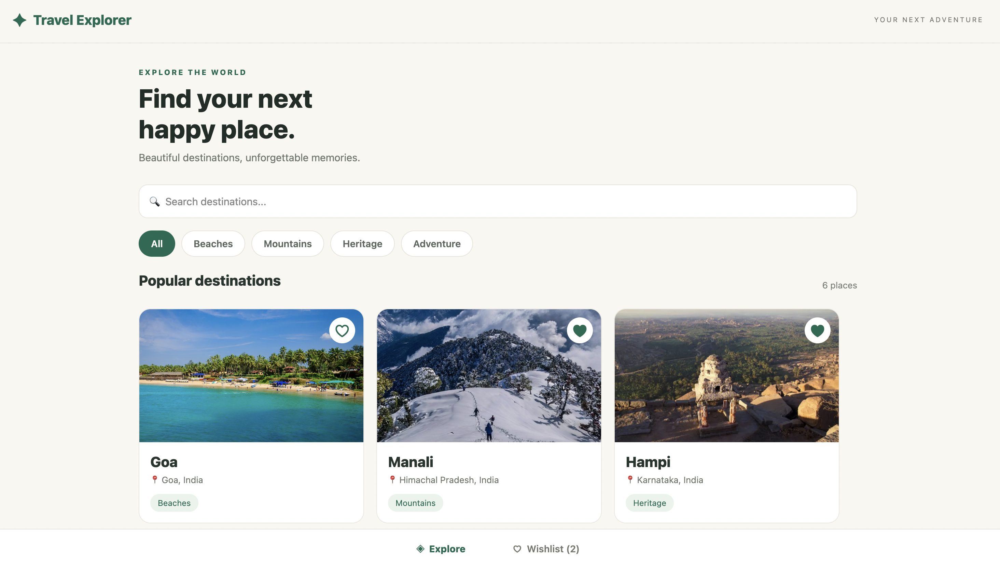
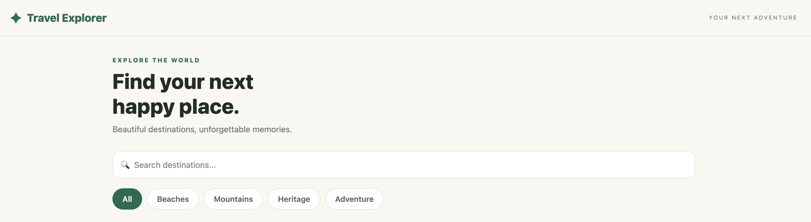
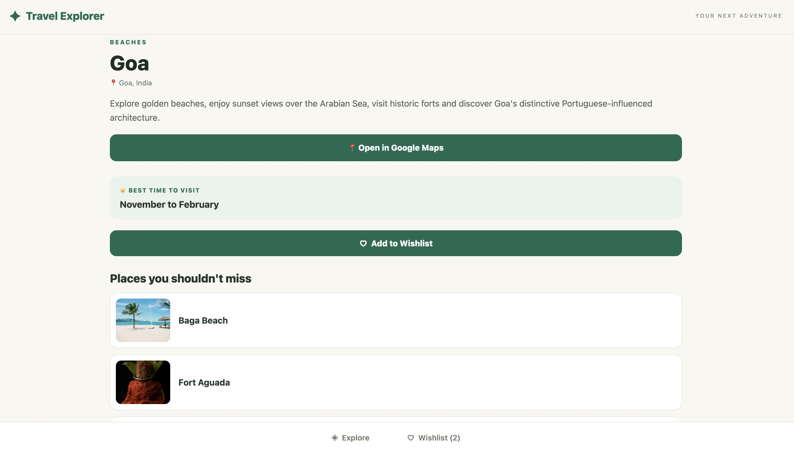
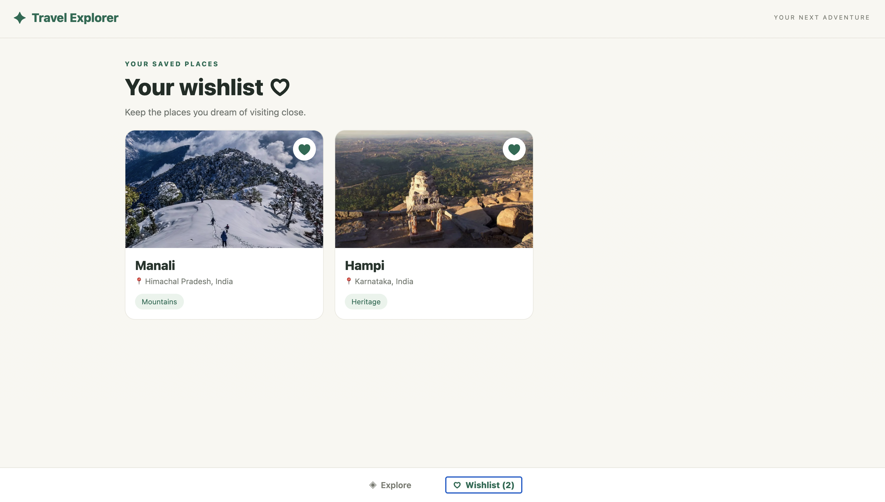

# 🌍 Travel Explorer App

A travel discovery app built with React Native and Expo that helps users explore beautiful destinations across India and save their favourite places to a wishlist.

## ✨ Features

- **Explore Destinations:** Browse six destinations across India.
- **Destination Details:** View descriptions, best times to visit, and popular attractions with images.
- **Search:** Find destinations by name or location.
- **Category Filters:** Filter destinations by Beaches, Mountains, Heritage, and Adventure.
- **Wishlist:** Add and remove favourite destinations on a separate wishlist screen.
- **Simple UI:** Clean design with easy navigation.
- **Google Maps Integration:** Open Google Maps for a selected destination directly from the destination details screen.
- **Persistent Wishlist:** Save and remove favourite destinations. Wishlist items remain saved even after refreshing or reopening the app using AsyncStorage.
## 📍 Destinations

| Destination | Category |
|---|---|
| Goa | Beaches |
| Manali | Mountains |
| Hampi | Heritage |
| Rishikesh | Adventure |
| Munnar | Mountains |
| Jaipur | Heritage |

## 🛠️ Technologies Used

- React Native
- Expo
- JavaScript
- React Hooks

## 🚀 Getting Started

### Prerequisites

Install Node.js and npm.

### Installation

1. Clone this repository:

   ```bash
   git clone YOUR_GITHUB_REPOSITORY_URL
   ```

2. Enter the project folder:

   ```bash
   cd TravelExplorer
   ```

3. Install dependencies:

   ```bash
   npm install
   ```

4. Start the app in your browser:

   ```bash
   npx expo start --web
   ```

## 📸 Screenshots

## Screenshots

### Home Screen


### Search and Filters


### Destination Details


### Wishlist



## Screenshots

### Home Screen


### Search and Filters


### Destination Details


### Wishlist


## 📁 Project Structure

- `App.js` — Main application and app functionality.
- `assets/` — Project assets.
- `app.json` — Expo configuration.
- `package.json` — Project dependencies and scripts.

## 💾 Data and Storage

The app uses static destination data. Wishlist changes are managed in the app and reset when the app restarts.

## 🔮 Future Improvements

- Add live weather information.
- Recommend destinations based on user preferences.

## 👩‍💻 Project

Created as part of the GDGC VNRVJIET App Development Volunteer Recruitment Assignment.
